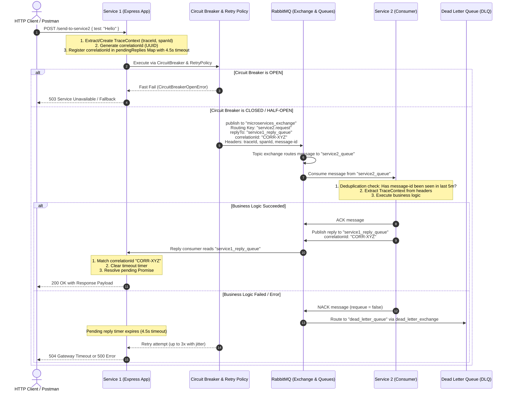

# Complete Architecture & In-Depth Technical Guide

This document provides a comprehensive technical guide to the RabbitMQ Microservices architecture implemented in this repository. It is designed to explain the system's end-to-end flow, resilience mechanisms, messaging semantics, and tracing identifiers in detail.

---

## 1. High-Level Architecture Overview

The system consists of two independently deployable microservices communicating asynchronously over a RabbitMQ topic exchange, augmented with enterprise-grade resilience and observability patterns:

```
RabbitMQ/
├── service1/          # Service 1 (HTTP API on port 3001 + RabbitMQ producer/consumer)
├── service2/          # Service 2 (HTTP API on port 3002 + RabbitMQ producer/consumer)
├── shared/            # Reusable core modules:
│   ├── rabbitmq-client.js         # Connection management, topology, deduplication
│   ├── circuit-breaker-manager.js # Opossum circuit breaker integration
│   ├── retry-policy.js            # Exponential backoff with jitter
│   ├── tracing.js                 # Distributed context propagation (Trace & Span IDs)
│   ├── logger.js                  # Winston structured logging
│   └── metrics.js                 # Prometheus metrics collection
└── docs/
    ├── CONFIGURATION.md           # Configuration & environment variables
    └── indetail.md                # This comprehensive reference guide
```

---

## 2. Complete Request-Response Flow

The sequence diagram below details the entire flow when a client submits an HTTP request to `Service 1` requesting work from `Service 2`.



---

## 3. Core Architectural Patterns

### A. Asynchronous Request-Reply (Two-Way RPC)

RabbitMQ queues are asynchronous and decoupled by nature. To enable request-reply semantics between microservices without HTTP coupling:

1. **`correlationId` (UUID)**: A unique identifier generated per outgoing request.
2. **`replyTo`**: Specifies the queue name where the consumer should deliver the response (e.g., `service1_reply_queue`).
3. **`pendingReplies` (In-Memory Map)**:
   ```javascript
   pendingReplies.set(correlationId, {
     resolve,
     reject,
     timeoutTimer,
     timestamp: Date.now(),
   });
   ```
4. **Dedicated Reply Consumer**:
   A single long-lived consumer listens on `service1_reply_queue`. When a message arrives, it inspects `properties.correlationId`, looks up the pending promise, clears the timer, and resolves the original HTTP request.

---

### B. Resilience: Circuit Breaker State Machine

Implemented in `shared/circuit-breaker-manager.js` using the **Opossum** library.

- **Analogy**: Works just like a residential electrical fuse box. If current spikes or a short occurs, the fuse blows to prevent an electrical fire. Similarly, if downstream dependencies fail, the circuit trips to prevent cascading service failure.

```mermaid
stateDiagram-v2
    [*] --> CLOSED: Initial Startup

    CLOSED --> OPEN: 50% failures reached within measurement window
    note right of CLOSED
      <b>CLOSED (Normal)</b>
      - All traffic flows through to RabbitMQ.
      - Monitors failure rates, timeouts, and successful executions.
    end note

    OPEN --> HALF_OPEN: After resetTimeout (30 seconds)
    note right of OPEN
      <b>OPEN (Tripped / Broken)</b>
      - Fails immediately (Fast-Fail).
      - No calls reach RabbitMQ.
      - Immediate fallback/503 returned.
    end note

    HALF_OPEN --> CLOSED: Probe request SUCCEEDS
    HALF_OPEN --> OPEN: Probe request FAILS
    note right of HALF_OPEN
      <b>HALF-OPEN (Trial / Testing)</b>
      - Allows 1 probe request through to check if Service 2 has recovered.
    end note
```



#### Configuration Options:

- `timeout: 15000` (15s): Maximum execution duration before timing out.
- `errorThresholdPercentage: 50`: Opens the breaker if 50% or more calls fail.
- `resetTimeout: 30000` (30s): Cooldown duration before attempting `HALF-OPEN`.

---

### C. Retry Policy with Exponential Backoff and Jitter

Implemented in `shared/retry-policy.js`.

- **The Problem**: If a service experiences momentary latency, retrying immediately can overwhelm it (the _thundering herd_ effect).
- **The Formula**:
  $$\text{Delay} = \min\left(\text{InitialDelay} \times \text{Multiplier}^{(\text{attempt} - 1)}, \text{MaxDelay}\right) \pm \text{Jitter}$$
- **Parameters**:
  - `maxAttempts`: 3
  - `initialDelay`: 1000 ms
  - `backoffMultiplier`: 2
  - `maxDelay`: 30000 ms
  - `jitter`: Adds $\pm 10\%$ random variance so concurrent retries do not synchronize.

---

### D. Dead Letter Queue (DLQ) & Message Deduplication

Implemented in `shared/rabbitmq-client.js`.

1. **Dead Letter Queue (`dead_letter_queue`)**:
   - Queues declare `x-dead-letter-exchange` and `x-dead-letter-routing-key`.
   - If a message is rejected with `nack(false)` or exceeds its TTL (Time-To-Live, default 60s), RabbitMQ automatically redirects it to `dead_letter_queue`.
   - Prevents lost data and enables offline analysis of poison messages.
2. **Message Deduplication**:
   - In distributed messaging, network reconnects can trigger message redelivery ("at-least-once" guarantee).
   - `RabbitMQClient` maintains an in-memory cache of recently processed message IDs with a 5-minute deduplication window (`300000 ms`).
   - Duplicate message packets are safely acknowledged (`ack`) and discarded without double execution.

---

## 4. Tracing & Identification Roles Explained

The architecture utilizes 4 key IDs across headers and payloads:

| Identifier                        | Belongs To            | Primary Role                                                                       | Real-World Analogy                                                         |
| :-------------------------------- | :-------------------- | :--------------------------------------------------------------------------------- | :------------------------------------------------------------------------- |
| **`traceId`**                     | Distributed Tracing   | Follows the **entire lifecycle of a request** across all microservices and queues. | The postal **Tracking Number** from origin to destination.                 |
| **`spanId`** (and `parentSpanId`) | Distributed Tracing   | Identifies **one specific unit/segment of execution** within a trace.              | A specific **checkpoint/sorting facility** the package stops at.           |
| **`correlationId`**               | RabbitMQ RPC          | Binds an **asynchronous response** back to its **original pending request**.       | An **order ticket / buzzer** at a food counter to collect the right order. |
| **`messageId`**                   | AMQP Message Delivery | Uniquely identifies an **individual physical message packet** for deduplication.   | The **barcode** printed on the physical shipping label.                    |

### Visual Identity Lifecycle:

```
Client Request ──► [HTTP POST /send-to-service2]
                    │
                    ├── traceId: "TRACE-AAA"       (Follows this user request everywhere)
                    ├── spanId:  "SPAN-001"        (Service 1 HTTP request duration)
                    │
                    ▼
           RabbitMQ Message
           ┌────────────────────────────────────────────────────────┐
           │ traceId:        "TRACE-AAA"   (Same trace)             │
           │ spanId:         "SPAN-002"   (Child span of SPAN-001)  │
           │ parentSpanId:   "SPAN-001"                             │
           │ correlationId:  "CORR-777"   (Links reply back to call)│
           │ messageId:      "MSG-999"    (Deduplication barcode)   │
           └────────────────────────────────────────────────────────┘
                    │
                    ▼
             Service 2 Consumes
             ├── Deduplication: Checks messageId ("MSG-999")
             ├── Logging: Winston logs with traceId ("TRACE-AAA")
             └── Sends Reply with correlationId ("CORR-777")
                    │
                    ▼
             Service 1 Matches correlationId ("CORR-777")
             └── Resolves pending Promise ──► Sends HTTP 200 to Client
```

---

## 5. Architectural Benefits Summary

- **Decoupling**: Services do not require knowledge of network topology, hostnames, or IP addresses of other services; they only communicate with RabbitMQ exchanges via routing keys.
- **Fault Isolation**: Outages or performance degradations in downstream services do not bring down upstream callers, protected by Circuit Breakers.
- **Load Leveling**: Traffic spikes are buffered inside RabbitMQ queues. Consumers process work steadily according to their `prefetchCount` limit.
- **Observability**: Every service exports Prometheus metrics (`/metrics`) and structured Winston logs correlated with distributed trace context.
